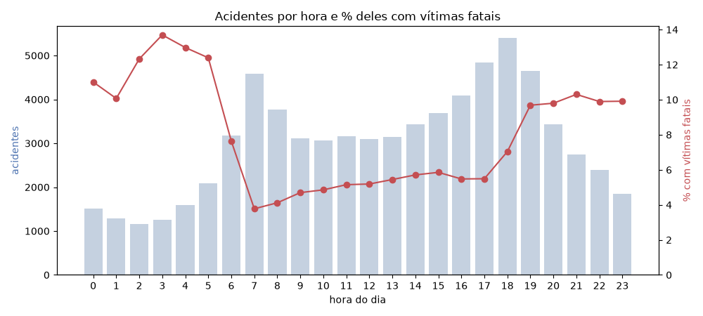

# acidentes-rodovias-sql

Pipeline em Python e PostgreSQL com os acidentes de 2025 nas rodovias federais, a partir dos dados abertos da PRF. Ele baixa o arquivo e confere o hash, limpa, carrega por `COPY` e responde 10 perguntas em SQL, com relatório e gráficos gerados por script.

[](https://github.com/9Arthur/acidentes-rodovias-sql/actions/workflows/ci.yml)

54 testes, 98% de cobertura no CI. Sem deploy: o resultado público é o [`RELATORIO.md`](RELATORIO.md), gerado pelo próprio pipeline e commitado.



## Três achados (72.529 acidentes de 2025)

- A madrugada é o período mais letal: às 3h, 13,7% dos acidentes têm vítima fatal, contra 9,7% às 19h, a hora com mais acidentes fatais em número.
- Nevoeiro e neblina têm a maior taxa de mortos por acidente (0,134, em 553 acidentes), e a chuva fica abaixo do céu claro (0,075 contra 0,085).
- Dos 10 trechos com mais acidentes, 5 são quilômetros seguidos da BR-101 em Santa Catarina, do km 204 ao 208.

## Como rodar

Requisitos: Docker e [uv](https://docs.astral.sh/uv/). Na raiz do repositório:

```bash
docker compose up -d --wait db
uv sync
uv run python -m acidentes.baixar && uv run python -m acidentes.limpar && uv run python -m acidentes.carregar && uv run python -m acidentes.relatorio
```

O último comando baixa o arquivo da PRF para `data/raw/` e para se o sha256 não for o fixado. Depois grava o Parquet em `data/clean/`, carrega a tabela `acidente` e escreve de novo o `RELATORIO.md` e os gráficos em `docs/img/`. Os testes rodam com `uv run pytest`, com o banco de pé; os que usam o banco criam schemas descartáveis e não tocam na tabela `acidente`.

## Decisões técnicas

- Escolhi fixar o sha256 do arquivo da PRF em vez de usar sempre a versão publicada, porque a PRF atualiza o arquivo do ano todo mês e os números mudariam sem aviso (AR-1).
- Escolhi aceitar só dependências com pelo menos 14 dias de publicação (`exclude-newer` do uv) em vez da última versão, porque é na release recém-publicada que aparecem versão quebrada e pacote comprometido (AR-4).
- Escolhi `COPY` para uma tabela temporária seguido de `INSERT ... ON CONFLICT DO NOTHING` em vez de `COPY` direto na tabela final, porque o `COPY` não aceita `ON CONFLICT` e a segunda carga pararia na chave primária (AR-6).
- Escolhi comparar o resultado inteiro de cada consulta com um esperado calculado à mão sobre 50 acidentes sintéticos em vez de conferir só que ela devolve linhas, porque consulta de análise erra em empate, nulo e arredondamento sem dar erro (AR-7).
- Escolhi gerar o relatório por script a partir das consultas testadas em vez de escrevê-lo à mão, porque editado à mão ele poderia divergir delas sem ninguém perceber (AR-8).

Todas as decisões, de AR-1 a AR-9, estão em [`docs/decisoes.md`](docs/decisoes.md).

## Estrutura

```
sql/                 10 consultas, uma pergunta por arquivo, comentadas
src/acidentes/
  baixar.py          download e conferência do sha256
  limpar.py          CSV da PRF para Parquet
  carregar.py        tabela acidente e carga idempotente por COPY
  consultas.py       executa sql/<nome>.sql
  relatorio.py       RELATORIO.md e gráficos
  banco.py           conexão pela DATABASE_URL
tests/               testes e fixture de 50 acidentes sintéticos
docs/decisoes.md     decisões técnicas
RELATORIO.md         resultado das 10 consultas nos dados de 2025
```

## O que ficou de fora

- Modelo preditivo, dashboard e mais de um ano de dados: a análise é só de 2025.
- Deploy e painel interativo: o relatório commitado já mostra o resultado.
- Dockerfile: só o banco precisa de contêiner. O pipeline roda uma vez e termina, então roda no `uv`.
- SQLAlchemy: a conexão é `psycopg` direto, sem ORM (AR-2).
- Outros formatos de data: o arquivo de 2025 vem com data ISO, e a limpeza aceita só esse formato (AR-5).
- A limpeza não valida encoding, variações das sentinelas nem formato de número; depende do arquivo fixado pelo hash (AR-1 e AR-5).
- Valor fracionário ou fora da faixa numa coluna inteira levanta `TypeError` do pandas, sem teste para isso.
- A carga não confere o hash do Parquet: confia no que a limpeza gerou.
- `mortos` ou `feridos` nulos desfazem a carga inteira, porque o `DEFAULT 0` não vale para nulo explícito.
- `acidentes.consultas` acha a pasta `sql/` pelo caminho do código-fonte: o pacote instalado fora do repositório não leva as consultas. O executor também não trata arquivo ausente, não valida o nome e não barra DDL; o nome vem só do código.
- A consulta 5 ordena pela taxa já arredondada.
- A ordem da consulta 7 não é provada pela fixture: MG e SC já saem na ordem certa sem o `ORDER BY`.
- `postgres:17` é uma tag móvel, no compose e no CI.
