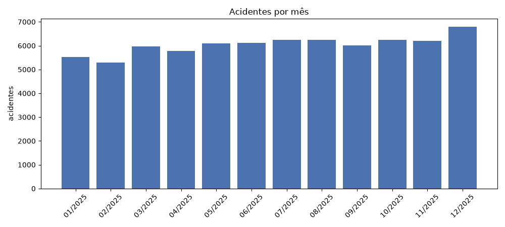
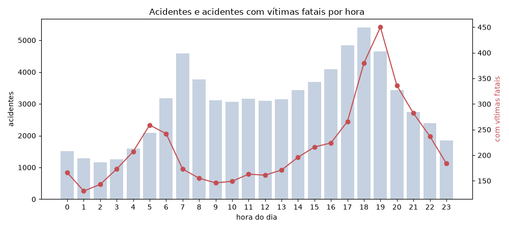
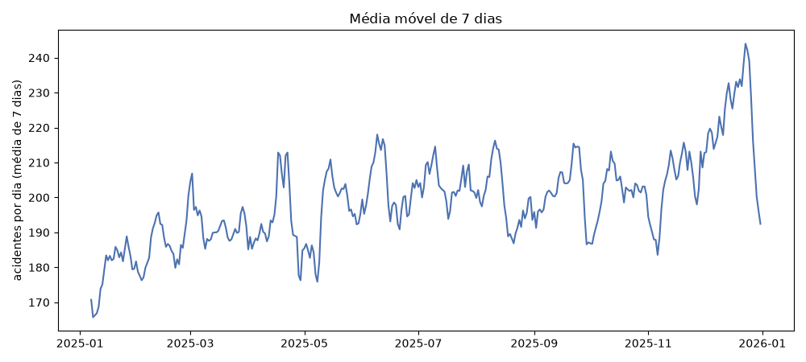

# Relatório — acidentes nas rodovias federais (PRF, 2025)

Gerado por `python -m acidentes.relatorio` a partir das consultas de `sql/`.

## 1. Acidentes por mês e tendência

Consulta: `sql/01_acidentes_por_mes.sql`

| mes | acidentes | variacao | variacao_pct |
|---|---|---|---|
| 2025-01-01 | 5528 |  |  |
| 2025-02-01 | 5287 | -241 | -4.4 |
| 2025-03-01 | 5960 | 673 | 12.7 |
| 2025-04-01 | 5786 | -174 | -2.9 |
| 2025-05-01 | 6096 | 310 | 5.4 |
| 2025-06-01 | 6122 | 26 | 0.4 |
| 2025-07-01 | 6238 | 116 | 1.9 |
| 2025-08-01 | 6246 | 8 | 0.1 |
| 2025-09-01 | 6017 | -229 | -3.7 |
| 2025-10-01 | 6252 | 235 | 3.9 |
| 2025-11-01 | 6209 | -43 | -0.7 |
| 2025-12-01 | 6788 | 579 | 9.3 |

## 2. Top 10 BRs por acidentes e por mortos

Consulta: `sql/02_top_brs.sql`

| br | acidentes | mortos | rank_acidentes | rank_mortos |
|---|---|---|---|---|
| 101 | 13014 | 760 | 1 | 1 |
| 116 | 11021 | 708 | 2 | 2 |
| 40 | 3502 | 214 | 3 | 4 |
| 381 | 3496 | 190 | 4 | 8 |
| 153 | 2789 | 282 | 5 | 3 |
| 163 | 2519 | 210 | 6 | 5 |
| 364 | 2264 | 173 | 7 | 9 |
| 277 | 2157 | 152 | 8 | 11 |
| 262 | 1769 | 169 | 9 | 10 |
| 376 | 1762 | 121 | 10 | 14 |
| 230 | 1745 | 192 | 11 | 7 |
| 316 | 1236 | 201 | 14 | 6 |

## 3. Hora do dia × gravidade

Consulta: `sql/03_hora_gravidade.sql`

| hora | acidentes | sem_vitimas | com_feridos | com_fatais |
|---|---|---|---|---|
| 0 | 1508 | 361 | 981 | 166 |
| 1 | 1291 | 305 | 856 | 130 |
| 2 | 1160 | 292 | 725 | 143 |
| 3 | 1263 | 340 | 750 | 173 |
| 4 | 1595 | 408 | 980 | 207 |
| 5 | 2090 | 444 | 1387 | 259 |
| 6 | 3169 | 462 | 2465 | 242 |
| 7 | 4583 | 485 | 3924 | 173 |
| 8 | 3765 | 443 | 3167 | 155 |
| 9 | 3108 | 429 | 2533 | 146 |
| 10 | 3069 | 434 | 2486 | 149 |
| 11 | 3165 | 447 | 2555 | 163 |
| 12 | 3103 | 391 | 2551 | 161 |
| 13 | 3141 | 411 | 2559 | 171 |
| 14 | 3434 | 450 | 2788 | 196 |
| 15 | 3690 | 542 | 2932 | 216 |
| 16 | 4089 | 571 | 3294 | 224 |
| 17 | 4845 | 642 | 3937 | 266 |
| 18 | 5398 | 709 | 4309 | 380 |
| 19 | 4646 | 664 | 3532 | 450 |
| 20 | 3429 | 583 | 2510 | 336 |
| 21 | 2737 | 497 | 1958 | 282 |
| 22 | 2395 | 433 | 1725 | 237 |
| 23 | 1856 | 395 | 1277 | 184 |

## 4. Dia da semana × tipo de acidente

Consulta: `sql/04_dia_semana_tipo.sql`

| isodow | dia | tipo | acidentes | pct_do_dia |
|---|---|---|---|---|
| 1 | segunda | Colisão traseira | 2115 | 20.6 |
| 1 | segunda | Saída de leito carroçável | 1387 | 13.5 |
| 1 | segunda | Colisão transversal | 1311 | 12.7 |
| 2 | terça | Colisão traseira | 1836 | 20.3 |
| 2 | terça | Colisão transversal | 1216 | 13.4 |
| 2 | terça | Colisão lateral mesmo sentido | 1117 | 12.3 |
| 3 | quarta | Colisão traseira | 2077 | 21.7 |
| 3 | quarta | Colisão transversal | 1295 | 13.6 |
| 3 | quarta | Colisão lateral mesmo sentido | 1179 | 12.3 |
| 4 | quinta | Colisão traseira | 2003 | 21.3 |
| 4 | quinta | Colisão transversal | 1307 | 13.9 |
| 4 | quinta | Saída de leito carroçável | 1151 | 12.2 |
| 5 | sexta | Colisão traseira | 2386 | 21.3 |
| 5 | sexta | Colisão transversal | 1650 | 14.7 |
| 5 | sexta | Colisão lateral mesmo sentido | 1364 | 12.2 |
| 6 | sábado | Colisão traseira | 2025 | 17.5 |
| 6 | sábado | Saída de leito carroçável | 1932 | 16.7 |
| 6 | sábado | Colisão transversal | 1381 | 12.0 |
| 7 | domingo | Saída de leito carroçável | 2193 | 19.1 |
| 7 | domingo | Colisão traseira | 1918 | 16.7 |
| 7 | domingo | Colisão transversal | 1146 | 10.0 |

## 5. Condição meteorológica × mortos por acidente

Consulta: `sql/05_meteo_mortos.sql`

| condicao_meteo | acidentes | mortos | mortos_por_acidente |
|---|---|---|---|
| Nevoeiro/Neblina | 553 | 74 | 0.1338 |
| Vento | 104 | 10 | 0.0962 |
| Céu Claro | 46375 | 3948 | 0.0851 |
| Nublado | 11435 | 955 | 0.0835 |
| Chuva | 6438 | 480 | 0.0746 |
| Garoa/Chuvisco | 2422 | 175 | 0.0723 |
| Sol | 4201 | 286 | 0.0681 |
| Neve | 1 | 0 | 0.0000 |

## 6. Trechos com mais acidentes

Consulta: `sql/06_trechos.sql`

| uf | br | km | acidentes |
|---|---|---|---|
| SC | 101 | 207 | 84 |
| SC | 101 | 205 | 80 |
| SC | 101 | 208 | 75 |
| SP | 116 | 219 | 70 |
| ES | 101 | 270 | 64 |
| SC | 101 | 206 | 62 |
| SC | 101 | 204 | 59 |
| PE | 101 | 70 | 57 |
| SP | 116 | 225 | 57 |
| RJ | 101 | 322 | 55 |

## 7. MG × SC

Consulta: `sql/07_comparacao_ufs.sql`

| uf | acidentes | mortos | mortos_por_acidente | pct_com_fatais |
|---|---|---|---|---|
| MG | 9570 | 765 | 0.0799 | 6.8 |
| SC | 8186 | 434 | 0.0530 | 4.6 |

## 8. Média móvel de 7 dias

Consulta: `sql/08_media_movel.sql`

365 linhas

| dia | acidentes | media_7d |
|---|---|---|
| 2025-01-01 | 193 |  |
| 2025-01-02 | 161 |  |
| 2025-01-03 | 179 |  |
| 2025-01-04 | 179 |  |
| 2025-01-05 | 164 |  |
| 2025-01-06 | 173 |  |
| 2025-01-07 | 146 | 170.71 |
| 2025-01-08 | 158 | 165.71 |
| 2025-01-09 | 165 | 166.29 |
| 2025-01-10 | 183 | 166.86 |
| 2025-01-11 | 192 | 168.71 |
| 2025-01-12 | 200 | 173.86 |
| 2025-01-13 | 182 | 175.14 |
| 2025-01-14 | 175 | 179.29 |
| 2025-01-15 | 187 | 183.43 |
| 2025-01-16 | 155 | 182.00 |
| 2025-01-17 | 192 | 183.29 |
| 2025-01-18 | 183 | 182.00 |
| 2025-01-19 | 203 | 182.43 |
| 2025-01-20 | 206 | 185.86 |
| 2025-01-21 | 168 | 184.86 |
| 2025-01-22 | 173 | 182.86 |
| 2025-01-23 | 165 | 184.29 |
| 2025-01-24 | 174 | 181.71 |
| 2025-01-25 | 208 | 185.29 |
| 2025-01-26 | 228 | 188.86 |
| 2025-01-27 | 185 | 185.86 |
| 2025-01-28 | 150 | 183.29 |
| 2025-01-29 | 146 | 179.43 |
| 2025-01-30 | 166 | 179.57 |
| 2025-01-31 | 189 | 181.71 |
| 2025-02-01 | 187 | 178.71 |
| 2025-02-02 | 220 | 177.57 |
| 2025-02-03 | 176 | 176.29 |
| 2025-02-04 | 156 | 177.14 |
| 2025-02-05 | 165 | 179.86 |
| 2025-02-06 | 176 | 181.29 |
| 2025-02-07 | 199 | 182.71 |
| 2025-02-08 | 228 | 188.57 |
| 2025-02-09 | 238 | 191.14 |
| 2025-02-10 | 187 | 192.71 |
| 2025-02-11 | 171 | 194.86 |
| 2025-02-12 | 171 | 195.71 |
| 2025-02-13 | 153 | 192.43 |
| 2025-02-14 | 197 | 192.14 |
| 2025-02-15 | 202 | 188.43 |
| 2025-02-16 | 220 | 185.86 |
| 2025-02-17 | 193 | 186.71 |
| 2025-02-18 | 167 | 186.14 |
| 2025-02-19 | 161 | 184.71 |
| 2025-02-20 | 147 | 183.86 |
| 2025-02-21 | 169 | 179.86 |
| 2025-02-22 | 219 | 182.29 |
| 2025-02-23 | 210 | 180.86 |
| 2025-02-24 | 232 | 186.43 |
| 2025-02-25 | 161 | 185.57 |
| 2025-02-26 | 189 | 189.57 |
| 2025-02-27 | 174 | 193.43 |
| 2025-02-28 | 219 | 200.57 |
| 2025-03-01 | 246 | 204.43 |
| 2025-03-02 | 227 | 206.86 |
| 2025-03-03 | 159 | 196.43 |
| 2025-03-04 | 167 | 197.29 |
| 2025-03-05 | 172 | 194.86 |
| 2025-03-06 | 184 | 196.29 |
| 2025-03-07 | 207 | 194.57 |
| 2025-03-08 | 202 | 188.29 |
| 2025-03-09 | 206 | 185.29 |
| 2025-03-10 | 179 | 188.14 |
| 2025-03-11 | 163 | 187.57 |
| 2025-03-12 | 175 | 188.00 |
| 2025-03-13 | 197 | 189.86 |
| 2025-03-14 | 208 | 190.00 |
| 2025-03-15 | 202 | 190.00 |
| 2025-03-16 | 209 | 190.43 |
| 2025-03-17 | 189 | 191.86 |
| 2025-03-18 | 173 | 193.29 |
| 2025-03-19 | 176 | 193.43 |
| 2025-03-20 | 183 | 191.43 |
| 2025-03-21 | 188 | 188.57 |
| 2025-03-22 | 195 | 187.57 |
| 2025-03-23 | 212 | 188.00 |
| 2025-03-24 | 199 | 189.43 |
| 2025-03-25 | 184 | 191.00 |
| 2025-03-26 | 168 | 189.86 |
| 2025-03-27 | 185 | 190.14 |
| 2025-03-28 | 225 | 195.43 |
| 2025-03-29 | 208 | 197.29 |
| 2025-03-30 | 199 | 195.43 |
| 2025-03-31 | 173 | 191.71 |
| 2025-04-01 | 138 | 185.14 |
| 2025-04-02 | 193 | 188.71 |
| 2025-04-03 | 161 | 185.29 |
| 2025-04-04 | 237 | 187.00 |
| 2025-04-05 | 217 | 188.29 |
| 2025-04-06 | 195 | 187.71 |
| 2025-04-07 | 187 | 189.71 |
| 2025-04-08 | 157 | 192.43 |
| 2025-04-09 | 177 | 190.14 |
| 2025-04-10 | 158 | 189.71 |
| 2025-04-11 | 221 | 187.43 |
| 2025-04-12 | 227 | 188.86 |
| 2025-04-13 | 227 | 193.43 |
| 2025-04-14 | 183 | 192.86 |
| 2025-04-15 | 172 | 195.00 |
| 2025-04-16 | 214 | 200.29 |
| 2025-04-17 | 246 | 212.86 |
| 2025-04-18 | 215 | 212.00 |
| 2025-04-19 | 190 | 206.71 |
| 2025-04-20 | 200 | 202.86 |
| 2025-04-21 | 247 | 212.00 |
| 2025-04-22 | 178 | 212.86 |
| 2025-04-23 | 152 | 204.00 |
| 2025-04-24 | 171 | 193.29 |
| 2025-04-25 | 187 | 189.29 |
| 2025-04-26 | 188 | 189.00 |
| 2025-04-27 | 198 | 188.71 |
| 2025-04-28 | 170 | 177.71 |
| 2025-04-29 | 168 | 176.29 |
| 2025-04-30 | 212 | 184.86 |
| 2025-05-01 | 175 | 185.43 |
| 2025-05-02 | 196 | 186.71 |
| 2025-05-03 | 175 | 184.86 |
| 2025-05-04 | 183 | 182.71 |
| 2025-05-05 | 195 | 186.29 |
| 2025-05-06 | 154 | 184.29 |
| 2025-05-07 | 168 | 178.00 |
| 2025-05-08 | 160 | 175.86 |
| 2025-05-09 | 235 | 181.43 |
| 2025-05-10 | 264 | 194.14 |
| 2025-05-11 | 237 | 201.86 |
| 2025-05-12 | 217 | 205.00 |
| 2025-05-13 | 171 | 207.43 |
| 2025-05-14 | 174 | 208.29 |
| 2025-05-15 | 178 | 210.86 |
| 2025-05-16 | 202 | 206.14 |
| 2025-05-17 | 241 | 202.86 |
| 2025-05-18 | 227 | 201.43 |
| 2025-05-19 | 209 | 200.29 |
| 2025-05-20 | 178 | 201.29 |
| 2025-05-21 | 183 | 202.57 |
| 2025-05-22 | 177 | 202.43 |
| 2025-05-23 | 212 | 203.86 |
| 2025-05-24 | 218 | 200.57 |
| 2025-05-25 | 196 | 196.14 |
| 2025-05-26 | 212 | 196.57 |
| 2025-05-27 | 164 | 194.57 |
| 2025-05-28 | 188 | 195.29 |
| 2025-05-29 | 156 | 192.29 |
| 2025-05-30 | 214 | 192.57 |
| 2025-05-31 | 237 | 195.29 |
| 2025-06-01 | 225 | 199.43 |
| 2025-06-02 | 183 | 195.29 |
| 2025-06-03 | 180 | 197.57 |
| 2025-06-04 | 212 | 201.00 |
| 2025-06-05 | 186 | 205.29 |
| 2025-06-06 | 239 | 208.86 |
| 2025-06-07 | 245 | 210.00 |
| 2025-06-08 | 246 | 213.00 |
| 2025-06-09 | 218 | 218.00 |
| 2025-06-10 | 162 | 215.43 |
| 2025-06-11 | 199 | 213.57 |
| 2025-06-12 | 208 | 216.71 |
| 2025-06-13 | 226 | 214.86 |
| 2025-06-14 | 189 | 206.86 |
| 2025-06-15 | 182 | 197.71 |
| 2025-06-16 | 186 | 193.14 |
| 2025-06-17 | 193 | 197.57 |
| 2025-06-18 | 206 | 198.57 |
| 2025-06-19 | 203 | 197.86 |
| 2025-06-20 | 188 | 192.43 |
| 2025-06-21 | 178 | 190.86 |
| 2025-06-22 | 222 | 196.57 |
| 2025-06-23 | 211 | 200.14 |
| 2025-06-24 | 195 | 200.43 |
| 2025-06-25 | 165 | 194.57 |
| 2025-06-26 | 207 | 195.14 |
| 2025-06-27 | 221 | 199.86 |
| 2025-06-28 | 208 | 204.14 |
| 2025-06-29 | 212 | 202.71 |
| 2025-06-30 | 227 | 205.00 |
| 2025-07-01 | 181 | 203.00 |
| 2025-07-02 | 173 | 204.14 |
| 2025-07-03 | 178 | 200.00 |
| 2025-07-04 | 242 | 203.00 |
| 2025-07-05 | 252 | 209.29 |
| 2025-07-06 | 218 | 210.14 |
| 2025-07-07 | 203 | 206.71 |
| 2025-07-08 | 199 | 209.29 |
| 2025-07-09 | 193 | 212.14 |
| 2025-07-10 | 195 | 214.57 |
| 2025-07-11 | 200 | 208.57 |
| 2025-07-12 | 216 | 203.43 |
| 2025-07-13 | 213 | 202.71 |
| 2025-07-14 | 199 | 202.14 |
| 2025-07-15 | 196 | 201.71 |
| 2025-07-16 | 173 | 198.86 |
| 2025-07-17 | 160 | 193.86 |
| 2025-07-18 | 216 | 196.14 |
| 2025-07-19 | 253 | 201.43 |
| 2025-07-20 | 214 | 201.57 |
| 2025-07-21 | 191 | 200.43 |
| 2025-07-22 | 207 | 202.00 |
| 2025-07-23 | 172 | 201.86 |
| 2025-07-24 | 184 | 205.29 |
| 2025-07-25 | 243 | 209.14 |
| 2025-07-26 | 210 | 203.00 |
| 2025-07-27 | 245 | 207.43 |
| 2025-07-28 | 205 | 209.43 |
| 2025-07-29 | 155 | 202.00 |
| 2025-07-30 | 171 | 201.86 |
| 2025-07-31 | 181 | 201.43 |
| 2025-08-01 | 232 | 199.86 |
| 2025-08-02 | 226 | 202.14 |
| 2025-08-03 | 221 | 198.71 |
| 2025-08-04 | 196 | 197.43 |
| 2025-08-05 | 176 | 200.43 |
| 2025-08-06 | 183 | 202.14 |
| 2025-08-07 | 208 | 206.00 |
| 2025-08-08 | 231 | 205.86 |
| 2025-08-09 | 261 | 210.86 |
| 2025-08-10 | 243 | 214.00 |
| 2025-08-11 | 212 | 216.29 |
| 2025-08-12 | 160 | 214.00 |
| 2025-08-13 | 181 | 213.71 |
| 2025-08-14 | 182 | 210.00 |
| 2025-08-15 | 190 | 204.14 |
| 2025-08-16 | 216 | 197.71 |
| 2025-08-17 | 218 | 194.14 |
| 2025-08-18 | 175 | 188.86 |
| 2025-08-19 | 165 | 189.57 |
| 2025-08-20 | 172 | 188.29 |
| 2025-08-21 | 172 | 186.86 |
| 2025-08-22 | 210 | 189.71 |
| 2025-08-23 | 227 | 191.29 |
| 2025-08-24 | 234 | 193.57 |
| 2025-08-25 | 161 | 191.57 |
| 2025-08-26 | 198 | 196.29 |
| 2025-08-27 | 156 | 194.00 |
| 2025-08-28 | 183 | 195.57 |
| 2025-08-29 | 239 | 199.71 |
| 2025-08-30 | 230 | 200.14 |
| 2025-08-31 | 188 | 193.57 |
| 2025-09-01 | 177 | 195.86 |
| 2025-09-02 | 166 | 191.29 |
| 2025-09-03 | 189 | 196.00 |
| 2025-09-04 | 187 | 196.57 |
| 2025-09-05 | 233 | 195.71 |
| 2025-09-06 | 236 | 196.57 |
| 2025-09-07 | 213 | 200.14 |
| 2025-09-08 | 187 | 201.57 |
| 2025-09-09 | 169 | 202.00 |
| 2025-09-10 | 184 | 201.29 |
| 2025-09-11 | 181 | 200.43 |
| 2025-09-12 | 232 | 200.29 |
| 2025-09-13 | 243 | 201.29 |
| 2025-09-14 | 243 | 205.57 |
| 2025-09-15 | 199 | 207.29 |
| 2025-09-16 | 168 | 207.14 |
| 2025-09-17 | 163 | 204.14 |
| 2025-09-18 | 180 | 204.00 |
| 2025-09-19 | 233 | 204.14 |
| 2025-09-20 | 249 | 205.00 |
| 2025-09-21 | 275 | 209.57 |
| 2025-09-22 | 240 | 215.43 |
| 2025-09-23 | 160 | 214.29 |
| 2025-09-24 | 165 | 214.57 |
| 2025-09-25 | 179 | 214.43 |
| 2025-09-26 | 188 | 208.00 |
| 2025-09-27 | 228 | 205.00 |
| 2025-09-28 | 202 | 194.57 |
| 2025-09-29 | 184 | 186.57 |
| 2025-09-30 | 164 | 187.14 |
| 2025-10-01 | 163 | 186.86 |
| 2025-10-02 | 178 | 186.71 |
| 2025-10-03 | 207 | 189.43 |
| 2025-10-04 | 242 | 191.43 |
| 2025-10-05 | 216 | 193.43 |
| 2025-10-06 | 202 | 196.00 |
| 2025-10-07 | 184 | 198.86 |
| 2025-10-08 | 199 | 204.00 |
| 2025-10-09 | 183 | 204.71 |
| 2025-10-10 | 231 | 208.14 |
| 2025-10-11 | 239 | 207.71 |
| 2025-10-12 | 254 | 213.14 |
| 2025-10-13 | 183 | 210.43 |
| 2025-10-14 | 179 | 209.71 |
| 2025-10-15 | 165 | 204.86 |
| 2025-10-16 | 184 | 205.00 |
| 2025-10-17 | 238 | 206.00 |
| 2025-10-18 | 214 | 202.43 |
| 2025-10-19 | 227 | 198.57 |
| 2025-10-20 | 213 | 202.86 |
| 2025-10-21 | 175 | 202.29 |
| 2025-10-22 | 162 | 201.86 |
| 2025-10-23 | 186 | 202.14 |
| 2025-10-24 | 223 | 200.00 |
| 2025-10-25 | 242 | 204.00 |
| 2025-10-26 | 224 | 203.57 |
| 2025-10-27 | 201 | 201.86 |
| 2025-10-28 | 172 | 201.43 |
| 2025-10-29 | 174 | 203.14 |
| 2025-10-30 | 186 | 203.14 |
| 2025-10-31 | 206 | 200.71 |
| 2025-11-01 | 198 | 194.43 |
| 2025-11-02 | 208 | 192.14 |
| 2025-11-03 | 187 | 190.14 |
| 2025-11-04 | 157 | 188.00 |
| 2025-11-05 | 173 | 187.86 |
| 2025-11-06 | 156 | 183.57 |
| 2025-11-07 | 240 | 188.43 |
| 2025-11-08 | 255 | 196.57 |
| 2025-11-09 | 247 | 202.14 |
| 2025-11-10 | 205 | 204.71 |
| 2025-11-11 | 170 | 206.57 |
| 2025-11-12 | 192 | 209.29 |
| 2025-11-13 | 185 | 213.43 |
| 2025-11-14 | 224 | 211.14 |
| 2025-11-15 | 232 | 207.86 |
| 2025-11-16 | 228 | 205.14 |
| 2025-11-17 | 212 | 206.14 |
| 2025-11-18 | 197 | 210.00 |
| 2025-11-19 | 210 | 212.57 |
| 2025-11-20 | 207 | 215.71 |
| 2025-11-21 | 206 | 213.14 |
| 2025-11-22 | 195 | 207.86 |
| 2025-11-23 | 265 | 213.14 |
| 2025-11-24 | 190 | 210.00 |
| 2025-11-25 | 168 | 205.86 |
| 2025-11-26 | 171 | 200.29 |
| 2025-11-27 | 191 | 198.00 |
| 2025-11-28 | 236 | 202.29 |
| 2025-11-29 | 271 | 213.14 |
| 2025-11-30 | 233 | 208.57 |
| 2025-12-01 | 219 | 212.71 |
| 2025-12-02 | 170 | 213.00 |
| 2025-12-03 | 208 | 218.29 |
| 2025-12-04 | 201 | 219.71 |
| 2025-12-05 | 228 | 218.57 |
| 2025-12-06 | 238 | 213.86 |
| 2025-12-07 | 245 | 215.57 |
| 2025-12-08 | 232 | 217.43 |
| 2025-12-09 | 210 | 223.14 |
| 2025-12-10 | 188 | 220.29 |
| 2025-12-11 | 184 | 217.86 |
| 2025-12-12 | 281 | 225.43 |
| 2025-12-13 | 269 | 229.86 |
| 2025-12-14 | 265 | 232.71 |
| 2025-12-15 | 200 | 228.14 |
| 2025-12-16 | 191 | 225.43 |
| 2025-12-17 | 217 | 229.57 |
| 2025-12-18 | 209 | 233.14 |
| 2025-12-19 | 270 | 231.57 |
| 2025-12-20 | 285 | 233.86 |
| 2025-12-21 | 251 | 231.86 |
| 2025-12-22 | 245 | 238.29 |
| 2025-12-23 | 231 | 244.00 |
| 2025-12-24 | 204 | 242.14 |
| 2025-12-25 | 188 | 239.14 |
| 2025-12-26 | 196 | 228.57 |
| 2025-12-27 | 199 | 216.29 |
| 2025-12-28 | 194 | 208.14 |
| 2025-12-29 | 189 | 200.14 |
| 2025-12-30 | 203 | 196.14 |
| 2025-12-31 | 178 | 192.43 |

## 9. Ranking de causas por UF

Consulta: `sql/09_causas_por_uf.sql`

81 linhas

| uf | posicao | causa | acidentes |
|---|---|---|---|
| AC | 1 | Reação tardia ou ineficiente do condutor | 51 |
| AC | 2 | Ausência de reação do condutor | 41 |
| AC | 3 | Acessar a via sem observar a presença dos outros veículos | 25 |
| AL | 1 | Acessar a via sem observar a presença dos outros veículos | 75 |
| AL | 2 | Velocidade Incompatível | 67 |
| AL | 3 | Ausência de reação do condutor | 52 |
| AM | 1 | Reação tardia ou ineficiente do condutor | 21 |
| AM | 2 | Ausência de reação do condutor | 13 |
| AM | 3 | Condutor Dormindo | 11 |
| AP | 1 | Acessar a via sem observar a presença dos outros veículos | 34 |
| AP | 2 | Reação tardia ou ineficiente do condutor | 23 |
| AP | 3 | Ausência de reação do condutor | 19 |
| BA | 1 | Ausência de reação do condutor | 509 |
| BA | 2 | Reação tardia ou ineficiente do condutor | 498 |
| BA | 3 | Acessar a via sem observar a presença dos outros veículos | 478 |
| CE | 1 | Ausência de reação do condutor | 159 |
| CE | 2 | Acessar a via sem observar a presença dos outros veículos | 157 |
| CE | 3 | Condutor deixou de manter distância do veículo da frente | 139 |
| DF | 1 | Ausência de reação do condutor | 151 |
| DF | 2 | Manobra de mudança de faixa | 142 |
| DF | 3 | Reação tardia ou ineficiente do condutor | 130 |
| ES | 1 | Reação tardia ou ineficiente do condutor | 360 |
| ES | 2 | Ausência de reação do condutor | 357 |
| ES | 3 | Acessar a via sem observar a presença dos outros veículos | 313 |
| GO | 1 | Reação tardia ou ineficiente do condutor | 518 |
| GO | 2 | Ausência de reação do condutor | 472 |
| GO | 3 | Ingestão de álcool pelo condutor | 280 |
| MA | 1 | Acessar a via sem observar a presença dos outros veículos | 186 |
| MA | 2 | Reação tardia ou ineficiente do condutor | 176 |
| MA | 3 | Ausência de reação do condutor | 152 |
| MG | 1 | Ausência de reação do condutor | 1692 |
| MG | 2 | Reação tardia ou ineficiente do condutor | 1164 |
| MG | 3 | Velocidade Incompatível | 1132 |
| MS | 1 | Ausência de reação do condutor | 428 |
| MS | 2 | Reação tardia ou ineficiente do condutor | 212 |
| MS | 3 | Acessar a via sem observar a presença dos outros veículos | 198 |
| MT | 1 | Reação tardia ou ineficiente do condutor | 500 |
| MT | 2 | Ausência de reação do condutor | 412 |
| MT | 3 | Acessar a via sem observar a presença dos outros veículos | 251 |
| PA | 1 | Ausência de reação do condutor | 200 |
| PA | 2 | Reação tardia ou ineficiente do condutor | 174 |
| PA | 3 | Acessar a via sem observar a presença dos outros veículos | 124 |
| PB | 1 | Ausência de reação do condutor | 353 |
| PB | 2 | Reação tardia ou ineficiente do condutor | 277 |
| PB | 3 | Acessar a via sem observar a presença dos outros veículos | 174 |
| PE | 1 | Ausência de reação do condutor | 453 |
| PE | 2 | Reação tardia ou ineficiente do condutor | 369 |
| PE | 3 | Acessar a via sem observar a presença dos outros veículos | 305 |
| PI | 1 | Ausência de reação do condutor | 299 |
| PI | 2 | Acessar a via sem observar a presença dos outros veículos | 212 |
| PI | 3 | Reação tardia ou ineficiente do condutor | 156 |
| PR | 1 | Reação tardia ou ineficiente do condutor | 1329 |
| PR | 2 | Ausência de reação do condutor | 1176 |
| PR | 3 | Acessar a via sem observar a presença dos outros veículos | 695 |
| RJ | 1 | Ausência de reação do condutor | 1112 |
| RJ | 2 | Reação tardia ou ineficiente do condutor | 1069 |
| RJ | 3 | Acessar a via sem observar a presença dos outros veículos | 486 |
| RN | 1 | Acessar a via sem observar a presença dos outros veículos | 225 |
| RN | 2 | Ausência de reação do condutor | 208 |
| RN | 3 | Reação tardia ou ineficiente do condutor | 168 |
| RO | 1 | Reação tardia ou ineficiente do condutor | 214 |
| RO | 2 | Acessar a via sem observar a presença dos outros veículos | 203 |
| RO | 3 | Ausência de reação do condutor | 197 |
| RR | 1 | Ingestão de álcool pelo condutor | 15 |
| RR | 2 | Ausência de reação do condutor | 13 |
| RR | 3 | Demais falhas mecânicas ou elétricas | 11 |
| RS | 1 | Ausência de reação do condutor | 768 |
| RS | 2 | Reação tardia ou ineficiente do condutor | 673 |
| RS | 3 | Acessar a via sem observar a presença dos outros veículos | 642 |
| SC | 1 | Reação tardia ou ineficiente do condutor | 1328 |
| SC | 2 | Ausência de reação do condutor | 1100 |
| SC | 3 | Acessar a via sem observar a presença dos outros veículos | 908 |
| SE | 1 | Ausência de reação do condutor | 72 |
| SE | 2 | Acessar a via sem observar a presença dos outros veículos | 64 |
| SE | 3 | Reação tardia ou ineficiente do condutor | 62 |
| SP | 1 | Reação tardia ou ineficiente do condutor | 1054 |
| SP | 2 | Ausência de reação do condutor | 920 |
| SP | 3 | Manobra de mudança de faixa | 353 |
| TO | 1 | Ausência de reação do condutor | 141 |
| TO | 2 | Reação tardia ou ineficiente do condutor | 100 |
| TO | 3 | Acessar a via sem observar a presença dos outros veículos | 79 |

## 10. Letalidade por fase do dia

Consulta: `sql/10_fase_dia.sql`

| fase_dia | acidentes | mortos | mortos_por_100 | pct_com_fatais |
|---|---|---|---|---|
| Amanhecer | 3447 | 472 | 13.7 | 11.2 |
| Plena Noite | 24781 | 2892 | 11.7 | 10.2 |
| Anoitecer | 3926 | 288 | 7.3 | 6.4 |
| Pleno dia | 40375 | 2391 | 5.9 | 5.1 |
